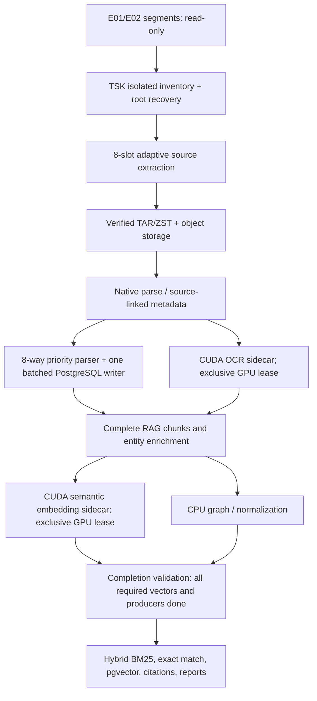

# Polaron2 Disk8 + CUDA: Legacy-speed / modern-coverage optimization

**Date:** 18 October 2026  
**Input:** current `polaron2(4).zip`, legacy `rag_new2_100(2).zip`  
**Scope:** DISK forensic E01/E02 (including segmented EWF), extracted shards, priority evidence, PostgreSQL, CUDA-derived RAG. Mobile and scanner paths were not deliberately redesigned.

## Executive summary

The legacy project has a shorter extract -> parse -> OCR -> RAG path. The current project adds stage-controlled source inventories, second-pass forensic priority parsers, normalized records, hash/size gates, recovery, per-source quality status, anomaly/offer-letter analysis, indexed search and report validation. **Simply copying the legacy project would reduce evidence/analysis parity.** The critical current bottleneck is that the second priority pass previously used a shared DB mutex through substantial source parsing. Other avoidable costs include multiple reopens of the same tar.zst and per-source commits.

This update uses **up to eight bounded CPU/I/O workers** for independent work units and a **separate CUDA lane** for GPU OCR and embedding. The GPU can run while CPU stages run; on a 12 GB card, OCR and embedding tasks should be mutually exclusive to avoid out-of-memory failures. An eight-slot limit is an upper bound, not a guarantee that disk, database and CUDA all have enough capacity to sustain it.

## Implementation changes

| Code | Change and reason | Evidential/quality guarantee |
| --- | --- | --- |
| `app/services/forensic_priority_evidence.py` | Eight CPU parsing threads; decompression once per extracted TAR part; bounded queue; **single independent tenant-scoped PostgreSQL writer**; `execute_values` batches; heartbeats report committed counts | Record inserts/checkpoint updates share commits; individual parser failures retained with explicit exception markers. Raw EWF source never modified. |
| `app/services/disk_slots.py` (already present) and `forensic_serial_policy.py` | Enforce max `DISK_SLOTS=8`, `PIPELINE_PARALLEL_SLOTS<=8`, shared sidecar CPU admission | Prevent accidental `10+` in these bounded helpers. A simultaneous second case needs its own scheduling limit. |
| `app/services/extract_shard_v45.py` | ZIP extraction SHA-256 performed as streamed bytes pass through a verified tar reader; EWF streaming remains conservative by default | File digest calculated from bytes that were consumed. Do not switch to experimental direct TAR until comparing checksums. |
| `app/services/extracted_disk.py` | Clamp EWF reader admission to eight; media-specific reductions remain | HDD is not forced into eight competing random reads. Existing isolated TSK root watchdog remains. |
| `app/services/extract_filters.py` | In `EXTRACT_MODE=full`, generic file-size cutoff cannot silently drop large files | Full means no generic size-driven selective skip; unreadable/unallocated evidence is still honestly labeled. |
| `app/services/host_capacity.py`, `app/config.py`, `.env.example` | Hardware planner caps parse/extract resources and preserves requested semantic embeddings (GPU defaults on if available and unset) | An automatic speed profile no longer silently turns semantic RAG off; explicit `RAG_EMBEDDING_ENABLED=false` is respected. |
| `app/retrieval/hybrid.py` | Stop disabling pgvector whenever the serial forensic job mode is active; query vector branch only when configured | BM25/FTS, exact-match, artifact boosting and source references are retained; vectors are an additional retrieval signal, not fabricated forensic evidence. |
| `app/services/disk_vector_sidecar.py` (new), `app/tasks.py`, `app/services/forensic_serial_stages.py` | Queue resumable pgvector `embedding_v2` backfill on `rag-index` after disk chunk/enrichment; batch SQL updates and committed heartbeat; retries if GPU lane is held; final validation waits for all requested vectors | **Does not delete or regenerate** source chunks; updates NULL embeddings only; checks embedding count and model vector dimension; protects 12 GB GPU with existing distributed heavy lease. |
| `backend/tests/test_disk8_cuda_quality_20261018.py`, `test_disk_vector_sidecar_20261018.py` | CPU-slot, evidence inclusion, vector index queue, CUDA dimension and registration tests | Does not imply a real-image speed benchmark. |

### Simplified execution flow



CUDA OCR can overlap CPU parsing. CUDA vectors can overlap CPU graph work. CUDA OCR and CUDA vectors are **serialized on one GPU** using `GPU_HEAVY_MAX_CONCURRENT=1` for 12 GB VRAM. Forensic source extraction remains a barrier before processing, so no report sees an incomplete acquisition as complete evidence.

## Configure safely

Review `config/disk8_cuda.env.example` and merge selected lines **into the existing production `.env`** (do not copy secrets from examples). In particular:

- `DISK_SLOTS=8`, `PIPELINE_PARALLEL_SLOTS=8`, `PARSE_WORKERS=8`, `EXTRACT_READ_SEMAPHORE=8`, `PARSE_SHARD_SIDECARS=5`.
- `EARLY_GPU_OCR=1`, `OCR_DEVICE=cuda`, `RAG_EMBEDDING_ENABLED=true`, `RAG_EMBEDDING_DEVICE=cuda`, `GPU_HEAVY_MAX_CONCURRENT=1`.
- `EXTRACT_THEN_PROCESS=true`, `EXTRACT_HASH_FILES=true`, `EXTRACT_DIRECT_TAR_STREAM=false` for source integrity. Work from registered server-local paths instead of re-copying evidence.
- For the RTX 5070 Ti Laptop 12 GB or similarly constrained GPU, keep **one heavy CUDA model** at once; GPU work still runs alongside CPU processing. Do not set both OCR and embedding to run high-memory GPU models simultaneously.
- On an HDD, measure 1–2 active readers against eight; seeking may dominate. Put scratch/object-store writes on SSD with sufficient free space. Do not infer `DISK_SOURCE_MEDIA=nvme` without inspection.
- `EXTRACT_MODE=forensic` remains the normal selective scope. Use `EXTRACT_MODE=full` for comprehensive acquired filesystem coverage, accepting additional run time. `DISK_PRIORITY_SIGNATURE_MODE=safe_deferred` defers *low-value OS binary signature classification* but preserves the source with an explicit unexamined marker; `full` inspects signatures and costs more.
- For retrieval reranking, `RAG_RERANK_ENABLED=true` is optional; benchmark latency/model VRAM before enabling it during a large GPU job. Embeddings are necessary for pgvector semantic retrieval; enabling them creates additional work and extends **end-to-end** completion time.

## Deployment / resume runbook

1. Pause new intake; allow active PostgreSQL write batches and extracted-shard uploads to **commit their checkpoints**. Stop/suspend processing through the application before recreating worker containers. Never use `docker compose down -v` and never delete EWF segments, MinIO volumes or PostgreSQL volumes.
2. Back up the existing project, production `.env`, PostgreSQL and MinIO (and register backup checksums). Do not deploy a code update in the middle of a live, non-resumable TSK syscall.
3. Merge the source ZIP into a copy of the deployed repository, preserving local secrets and storage path mappings. Apply required existing schema migrations and confirm `embedding_v2 vector(1024)` exists in every relevant firm schema. Optional index for very large corpora: `(job_id,id) WHERE embedding_v2 IS NULL AND length(content)>0` on `rag_chunks`; create it during a maintenance window after checking existing indexes.
4. From the same Compose file(s) used in production, validate and rebuild (`docker compose config --quiet`, `docker compose build api`), then recreate **only the idle affected workers** (`worker-disk`, `worker-parse`, `worker-rag-gpu`, `worker-ocr-gpu` and services containing these modules); service names may differ with your Compose profile. Because source code is often bind-mounted under `/app`, verify the effective Compose definitions instead of assuming a rebuild is always required.
5. Verify CUDA inside GPU worker (`nvidia-smi` or `torch.cuda.is_available()`), all configured Redis/DB/MinIO health checks, GPU lock status, disk read-mounts, and the `rag-index` worker subscription. Confirm source hash counts and report readiness counters on a test job before production rollout.
6. Resume through the app's checkpoint protocol. Do not restart extraction from zero or reset parsed/checkpointed rows by deleting case data. A queued vector sidecar updates only missing `embedding_v2` rows.

Example commands, run from the project root in PowerShell after a safe checkpoint/backup:

```powershell
docker compose config --quiet
docker compose build api
docker compose up -d --no-deps --force-recreate worker-parse worker-rag-gpu worker-ocr-gpu
# Restart worker-disk only after the extraction worker has safely stopped.
```

## What to measure in a real A/B run

Use a **separate job ID** for the *same* source disk image on identical hardware/storage; keep `EXTRACT_MODE`, file-size policy, OCR model, RAG coverage, and media type identical. Record stage-level timings and total wall clock, source paths, SHA-256/size, failed/skipped file counts, processed records, TSK inventory progress, priority `individual_source_reads`, `priority_db_insert_seconds`, OCR coverage, vector-null count and citation correctness. Compare not only total throughput, but also missing/unreadable/deleted evidence and false positives. The old project does not process the same total workload.

**Acceptance criteria** (to verify on host): no duplicate or missing acquired source paths, stable job_artifact hash/size/source provenance, final stage 100% only when no producers or requested vector work is pending, and no CUDA OOM during concurrent CPU operation. Suggested goal of a 60 GB image within ~30–35 minutes is a *target*, not a confirmed result. On compressed E01/USB/HDD or 500 GB images, throughput depends substantially on random-read pressure and number of parsers.

## Validation completed in this workspace

- Source-level compilation (`py_compile`), targeted synthetic forensic regression tests, strict eight-worker concurrency checks and schema/capacity assertions.
- **55 targeted tests passed** at this point, covering extraction planner, priority evidence writes, TSK recovery and vector-sidecar static/behavioral checks. Tests run without a live PostgreSQL/MinIO/NVIDIA GPU.
- **Not performed:** end-to-end ingestion on real E01/E02 segments, production Postgres 16+, MinIO, Redis, CUDA workers, report rendering or full suite. This runtime lacks runtime `psycopg2`, `celery`, `zstandard` and an NVIDIA GPU. Production performance and forensic equivalence therefore remain to be measured; no SLA or 95% accuracy is asserted from synthetic tests.

### Known constraints

1. EWF/TSK root opening can still stall on problematic media; existing isolated process watchdog and alternate method are retained, not replaced by speculative unsafe retries.
2. Eight parse workers do not imply eight times speed on Python GIL-bound code or a single non-seekable compressed TAR. Parallelism helps across independent parts; OS/HDD seek throughput can limit scaling.
3. If `rag-index` is not deployed, GPU leases fail, or model output does not match vector(1024), the job will remain `writing in`/incomplete rather than incorrectly report finished semantic coverage. Fix the resource/configuration and resume with the same evidence and partial embeddings.
4. The modified sample `.env.example` is sanitized. Real credentials/configuration are intentionally **excluded** from the deliverable. The original repository's older release/change notes may describe superseded assumptions; this release note defines the specific modifications.
