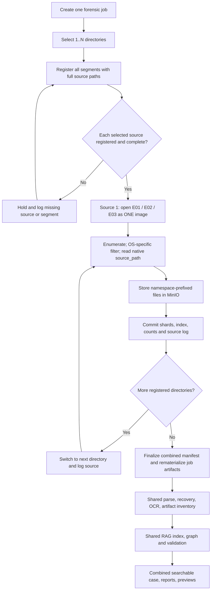

# Multi-directory E01 evidence — one job, separate source images, one artifact pipeline

## Contract

- One forensic `job_id` owns **one or more selected evidence directories**. Registration finishes before extraction starts. A registration failure prevents the multi-folder UI from starting the job.
- `image.E01` and `image.E02` in directory A belong to **A**, not to the identically named files in B or C. Readiness, source path, logs and source OS are tracked independently.
- Each directory contributes a stable `namespace` built from its full canonical source path (basename plus a SHA-256-derived suffix). In a multi-directory job, the archived/indexed artifact path is `namespace/relative-file-path`; a separate `source_path` keeps the original EWF path for reading bytes. Identical hashes or names across source folders are not collapsed.
- The first source uses the standard disk extractor; subsequent sources are opened one at a time by the directory-append stage. Every successful source appends its MinIO shards and index records to the same job manifest; the manifest keeps `segment_paths`, `extracted_directories`, `directory_stats`, and `parts_map`. Each published index **and** manifest uses a new object key so previously committed snapshots remain immutable during retries.
- Parsing/materialization, recovery, inventory, OCR, RAG, graph and validation operate on the **combined manifest/index** after all selected directories have been saved and registered. Each directory is filtered using its own detected OS.
- With just one directory, the original single-image flow and unprefixed artifact paths remain unchanged.
- A source missing an E01 segment is held and logged as incomplete; an unmountable E01 or empty filesystem inventory is an error, not a synthetic folder extraction. A failed appended materialization persists a recovery marker and blocks the downstream handoff until that registration succeeds.

## Flow



## Evidence and log examples

```
Directory 1 of 3: extracting only images (2 segment file(s)); source=/cases/A/images
Directory 1 extraction saved — 187,000 files; waiting for remaining source directories
Switching to source directory: /cases/B/images (2 segment file(s), namespace=images--...)
Directory 2 of 3 saved: /cases/B/images. Combined index now contains 319,000 files (... bytes).
Switching to source directory: /cases/C/images (1 segment file(s), namespace=images--...)
Directory 3 of 3 saved: /cases/C/images. Combined index now contains 400,000 files (... bytes).
All evidence directories saved and registered. Starting shared parse, OCR, artifact inventory, RAG, graph, and validation on the combined index.
```

The display panel shows each directory's actual source path, extracted count and state. The last directory raises `progress_pct` to 100; the first source of a multiple-source job cannot mark extraction globally complete.

## Changed files

- `backend/app/services/disk.py`: readiness/source separation, mount metadata preservation, first-source namespace, initial directory stats/logs and first-pass progress.
- `backend/app/services/virtual_disk.py`: ordered parent-folder grouping and stable namespaces.
- `backend/app/services/extracted_disk.py`: namespace only **after** original-source OS detection and path filtering.
- `backend/app/services/extract_shard_v45.py`: read raw `source_path` while writing namespaced archive/index paths.
- `backend/app/services/next_evidence_directory.py`: selected source order, readiness gating, source transitions, combined-index stats, downstream barrier, final progress and materialization errors.
- `backend/app/services/host_evidence.py`: folder-scoped readiness and registration audit metadata.
- `frontend/src/lib/types/forensic.ts`, `frontend/src/components/forensic/{HostEvidencePanel,SerialPipelineBanner,JobProgressBanner}.tsx`: folder-by-folder validation and display.
- `backend/tests/test_multi_directory_identity_20261102.py`: three-folder and repeated-name regression tests.

## Verification and deployment

Run in the target Python environment with all dependencies installed:

```
cd backend
pytest -q tests/test_multi_directory_identity_20261102.py tests/test_next_evidence_directory_20261023.py tests/test_multi_directory_extract_20261023.py
```

Run the complete backend suite and compile/build frontend in the application's normal Docker environment. For acceptance, mount **three small, different E01 source images** (including two directories both named `images`), verify `directory_stats` and `index.jsonl.zst` contain all three namespaces, verify no bytes are conflated, run a single-directory job, and confirm UI logs / artifact previews / RAG each retain source context. These full-stack checks are **not performed** in this file-only test environment.

The checks above do not assert live EWF decoding, PostgreSQL migration readiness, MinIO availability, or end-to-end content accuracy.
